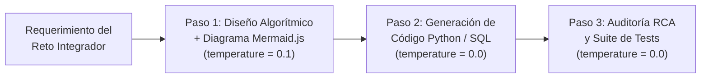

# Laboratorio Práctico Hora 3: Pipeline de Prompt Chaining de 3 Pasos para tu Reto Integrador
**Módulo 3: Soluciones con IA Generativa — Clase 3: HACER (Parte 1)**
**Duración estimada:** 20 minutos | **Modalidad:** Trabajo por Equipos del Reto Integrador en Databricks

---

## 1. Propósito del Taller
En lugar de usar la IA mediante un único "mega-prompt" frágil, las arquitecturas modernas de Ingeniería de Datos y Software descomponen el problema en una **cadena modular de prompts (*Prompt Chaining*)**.

En este taller, cada equipo diseñará y ejecutará en Databricks un **pipeline funcional de 3 pasos encadenados** aplicado directamente al dominio de su **Reto Integrador**:

---

## 2. Especificación de los 3 Eslabones del Pipeline

### Eslabón 1: Formalización de Reglas y Diagrama de Flujo (`Mermaid.js`)
- **Entrada:** Descripción en lenguaje natural de un proceso clave del Reto Integrador de tu equipo (ej. validación de solicitudes, clasificación de documentos, transformación de datos, motor de alertas).
- **Proceso:** El primer prompt debe extraer las entradas con sus tipos de datos, definir las condiciones de decisión y generar un diagrama `flowchart TD` válido en sintaxis `Mermaid.js`.
- **Salida 1:** Especificación algorítmica + código Mermaid renderizable.

### Eslabón 2: Síntesis de Código Productivo (Python o Databricks SQL)
- **Entrada:** La salida completa del **Eslabón 1**.
- **Proceso:** El segundo prompt toma la especificación y el flujo Mermaid del Paso 1 y genera una función en Python con *Type Hints* (o una consulta Databricks SQL parametrizada) que implemente fielmente cada rama condicional.
- **Salida 2:** Código fuente limpio y ejecutable.

### Eslabón 3: Auditoría de Casos Borde y Generación de Pruebas
- **Entrada:** La especificación del **Eslabón 1** + el código generado en el **Eslabón 2**.
- **Proceso:** El tercer prompt actúa como un Ingeniero Senior de QA: audita posibles bugs (valores nulos, divisiones por cero, tipos inesperados) y genera casos de prueba automatizados (`assert`).
- **Salida 3:** Reporte de auditoría + casos de prueba verificados.

---

## 3. Instrucciones Paso a Paso
1. Abran `clase03/05_ejercicios/hora3_starter.py` en Databricks.
2. En `# TODO 1`, reemplacen o personalicen el diccionario `RETO_INTEGRADOR_EQUIPO` con el nombre de su equipo y una regla o proceso real de su proyecto.
3. En `# TODO 2`, completen el prompt del **Paso 1** (Especificación + Diagrama `Mermaid.js`).
4. En `# TODO 3`, completen el prompt del **Paso 2** inyectando `{salida_paso_1}` para generar el código Python/SQL.
5. En `# TODO 4`, completen el prompt del **Paso 3** inyectando `{salida_paso_2}` para auditar y generar los tests.
6. Ejecuten todo el notebook y visualicen el diagrama Mermaid y la tabla de telemetría de su cadena.
